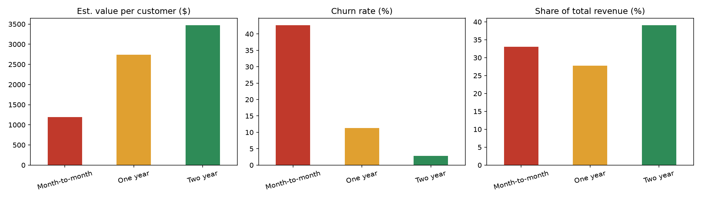

# Membership Tier Value Analysis

Calculates what each membership tier is worth using customer contract data, and recommends how to act on it. Built as a repeatable process: swap in a different customer file and the same script reruns the whole analysis.

## Goal

Figure out which membership tier is worth the most, which one loses customers fastest, and what a business should do about it.

## Data

[Telco Customer Churn](https://www.kaggle.com/datasets/blastchar/telco-customer-churn) (Kaggle, IBM sample data, about 7,000 customers).

Tiers are the `Contract` column: Month-to-month, One year, Two year.

The raw CSV is not included in this repo. Download it from the link above and put it in the project folder.

## What the script does

1. **Loads** the customer file.
2. **Cleans** it: removes duplicate customer IDs, fixes `TotalCharges` (stored as text, with blanks for brand-new customers), trims whitespace, and converts churn Yes/No to 1/0. Every fix is logged.
3. **Calculates per tier:** customer count, share of customers, average monthly charge, average tenure, churn rate, total revenue, share of revenue, and estimated value per customer (average monthly charge multiplied average tenure).
4. **Outputs** a summary table, charts, and a draft write-up.

## Cleaning log

- Loaded 7043 rows, 21 columns.
- Removed 0 duplicates.
- Dropped 11 rows with blank TotalCharges (tenure 0, no billing history).
- Final clean rows: 7032.

## Results

| Tier           | Customers | % of Customers | Avg Monthly Charge | Avg Tenure (months) | Churn Rate | Est. Value / Customer | % of Revenue |
|:---------------|----------:|---------------:|-------------------:|--------------------:|-----------:|----------------------:|-------------:|
| Month-to-month |     3,875 |          55.1% |             $66.40 |                18.0 |      42.7% |             $1,195.20 |        33.0% |
| One year       |     1,472 |          20.9% |             $65.08 |                42.1 |      11.3% |             $2,739.87 |        27.8% |
| Two year       |     1,685 |          24.0% |             $60.87 |                57.1 |       2.8% |             $3,475.68 |        39.1% |



## Findings

- **Two-year members are worth the most:** about $3,476 per customer, 3x a month-to-month member.
- **Churn drops as commitment goes up:** 42.7% for month-to-month, 11.3% for one year, 2.8% for two years.
- **Month-to-month is the biggest tier but not the most valuable:** 55% of customers, only 33% of revenue.
- **Two-year is the smallest-effort revenue:** 24% of customers bring in 39% of revenue.
- **Monthly price barely changes across tiers** ($61 to $66), so the value gap comes from how long members stay, not what they pay.

## Recommendation

- **Move month-to-month members to longer commitments.** Send an upgrade offer after their first few months, when they're settled in but haven't left yet.
- **Build a welcome series for new members** to cut early churn, since that's where the biggest tier loses people.
- **Add a win-back email** for members who cancel or go quiet.
- **Protect the two-year tier** with anniversary emails and perks, since they're the most valuable and rarely leave.
- **With real winery data,** repeat this analysis using actual club tiers and renewal dates instead of contract type.

## Limitations

- The data is a snapshot, so tenure is time so far, not a full customer lifetime.
- Estimated value (average monthly charge multiplied by average tenure) is a rough estimate, not a true lifetime value.
- Tiers here are contract types from a telecom company. With real club data I would tier by actual membership level and use real renewal and cancellation dates for retention.
- Month-to-month tenure looks lower partly because customers who churned stopped accumulating months, so the value gap may be a bit overstated.

## How to run

```
python -m venv venv
source venv/bin/activate        # Windows: venv\Scripts\activate
pip install -r requirements.txt
python tier_analysis.py
```

Put `WA_Fn-UseC_-Telco-Customer-Churn.csv` in the same folder first.

Outputs: `tier_summary.csv`, `clean_customers.csv`, `tier_charts.png`, `summary.md`.
